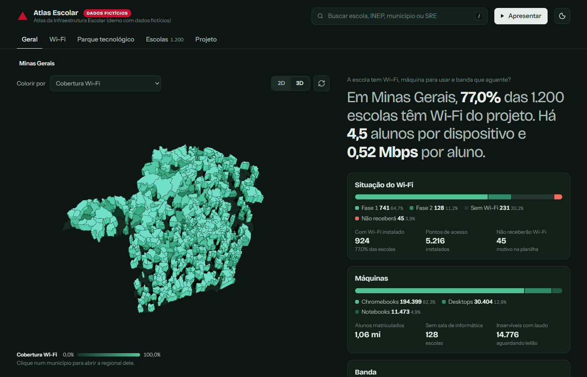

# Atlas Escolar — demo

**Atlas da Infraestrutura Escolar (demo com dados fictícios):** planilhas de Wi-Fi e de parque tecnológico viram um banco SQLite e um painel web estático com mapa 2D/3D das 47 regionais de ensino de Minas Gerais. Só Python da biblioteca padrão, sem servidor de aplicação.

> **Dados fictícios.** Todas as escolas, códigos INEP e números deste repositório são inventados por `gerar_dados_demo.py`. A versão real roda internamente. Esta demo foi inspirada num painel que construí para a rede estadual de ensino, mas **não é um produto oficial** e não usa marcas oficiais. Só a geografia é real e pública: a malha municipal do IBGE e a divisão dos municípios entre as regionais (SREs).



**▶ Demo ao vivo:** https://joaovitorgdev.github.io/atlas-escolar-demo/

## O que faz

- **Mapa 2D/3D** de Minas Gerais por município, colorido pela métrica escolhida (cobertura de Wi-Fi, alunos por dispositivo, Mbps por aluno...). Um clique entra na regional, outro no município; `Esc` volta um nível.
- **Recortes** Estado → SRE → município, com números, lista e gráficos que acompanham o mapa.
- **Busca** (`/` ou `Ctrl+K`) por escola, INEP, município ou SRE.
- **Ficha da escola**: Wi-Fi do projeto, fase, vistoria, parque tecnológico e internet.
- **Aba Escolas**: filtros, fila de prioridade, exportação CSV e impressão.
- **Modo apresentação**: passeio em tela cheia pelas 47 regionais, com minimapa e gráficos.
- Tema claro e escuro, layout para celular e para telas ultrawide.

## Arquitetura

```
planilhas/wifi.xlsx ─┐                    ┌──> dados/infra.db   SQLite: escola, parque, sre, municipio,
planilhas/parque.xlsx┴──> build.py ───────┤                     retirada, projeto + view resumo_sre
fontes/ (IBGE, públicos) ─┘               └──> site/dados.js    site estático (HTML + JS + ECharts via CDN)
                                               site/mapa.js
```

- `gerar_dados_demo.py` escreve planilhas fictícias com as mesmas abas e cabeçalhos das reais.
- `build.py` lê o `.xlsx` direto do ZIP/XML, acha as colunas pelo texto do cabeçalho, consolida as fontes (cadastro, Fase 1, Fase 2, parque tecnológico) e grava o banco e o `dados.js`.
- `site/` é estático: abre em qualquer servidor de arquivos (GitHub Pages, `python -m http.server`, pasta de rede).

## Decisões de projeto

- **Só biblioteca padrão.** Nada de pandas ou openpyxl: um `.xlsx` é um ZIP de XML, e `zipfile` + `xml.etree` resolvem. Instalação zero, nada para atualizar.
- **Custo zero de servidor.** A consolidação roda uma vez, fora do navegador; o painel é um site estático que carrega os dados prontos.
- **Colunas pelo nome, não pela posição.** Cada campo tem apelidos de cabeçalho; mover ou renomear coluna na planilha não quebra o build.
- **Números auditáveis.** Na versão real, os testes conferem os totais contra a planilha de origem e o painel antigo (foi assim que apareceu uma escola contada duas vezes). Aqui os testes conferem a consistência: cada escola numa regional, soma por regional igual ao total.
- **SQLite junto do site.** O mesmo conjunto vira um banco consultável com SQL, DB Browser, Excel ou Power BI.

## Como rodar

Requer Python 3.10+.

```bash
python gerar_dados_demo.py   # planilhas fictícias em planilhas/
python build.py              # dados/infra.db e site/dados.js
python rodar.py              # abre o painel em http://127.0.0.1:8000
```

O `site/dados.js` fictício já vem no repositório, então o site também pode ser publicado direto pelo GitHub Pages a partir da pasta `site/`. O mapa, os gráficos e as fontes vêm de CDN.

## Testes

```bash
python -m pytest -q
```

`tests/test_build.py` gera as planilhas numa pasta temporária, roda a consolidação e confere: quantidade de escolas, 47 regionais, toda escola com SRE, todo município com feição no mapa, soma por regional igual ao total geral e gerador determinístico. O CI (`.github/workflows/ci.yml`) roda gerador, build e testes a cada push.

## Consultas no banco

```sql
SELECT * FROM resumo_sre ORDER BY mbps_por_aluno;

SELECT e.nome, m.nome AS municipio, e.alunos, e.velocidade
FROM escola e JOIN municipio m ON m.id = e.municipio_id
WHERE e.atendimento = 0 AND e.wifi = 0 AND e.alunos > 0
ORDER BY e.velocidade * 1.0 / e.alunos;
```

Códigos: `wifi` 0 sem / 1 contemplada / 2 ENEC; `zona` 0 urbana / 1 distrito / 2 rural; `atendimento`, `salaInfo` e `wifiProprio` valem 1 sim, 0 não, −1 sem resposta.

## Licença

MIT. Veja [LICENSE](LICENSE).
